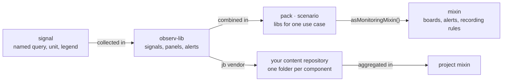
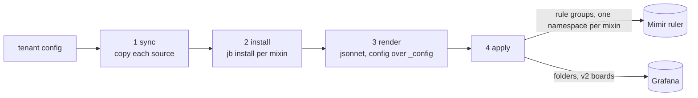
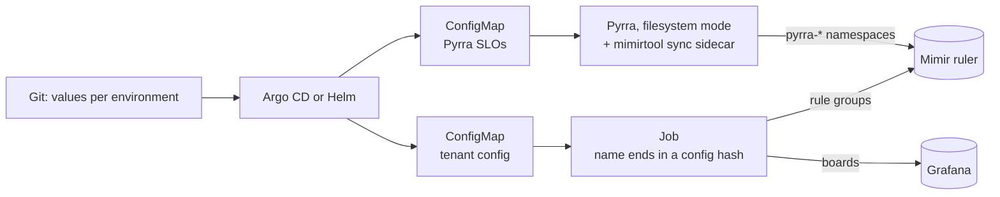

# From mixins to a stack

observ-viz content reaches a running stack through
[monitor-tools](https://github.com/cznewt/monitor-tools). One config per tenant
lists the mixins that tenant gets. A run renders them and applies the result to
the tenant's Mimir and Grafana.

## The model



- A **signal** is one PromQL query with its unit, legend and description (see
  [Concepts](concepts.md#signals)).
- An **observ-lib** holds the signals, panels and alert rules of one technology.
- A **scenario** picks libs for a use case, and `asMonitoringMixin()` exports it
  as `{grafanaDashboards, prometheusAlerts, prometheusRules}` (see
  [Reference & scenarios](reference.md)).
- Your own content, such as services, SLOs and runbooks, lives in a separate
  repository. It vendors observ-viz with jb and builds on the same libraries,
  for example `libs/service-observ-lib` for a service board.

## One config per tenant

monitor-tools reads one YAML config per tenant:

```yaml
name: shop
prometheus:
  render: mimirtool
grafana:
  render: grafanactl
mixins:
  shop:                       # your project mixin
    source:
      directory: {path: /mixins/src/content}
      includePaths: [projects/shop/**/*]
      newRootPath: projects/shop
    jpaths: ['../content', 'vendor/github.com/cznewt/observ-viz']
    config: {mimirNamespace: shop, grafanaDashboardFolder: Shop}
  k8s:                        # observ-viz libs, picked by name
    source:
      directory: {path: /mixins/observ-viz-mixin}
    config: {scenario: libs, libs: [kubernetes.pod, kubernetes.cadvisor], mimirNamespace: k8s}
libs:
  content:                    # shared code every mixin reaches as ../content
    source:
      directory: {path: /mixins/src/content}
      includePaths: [projects/common/**/*]
```

- `source` is a `directory` or a git checkout. `includePaths` and `newRootPath`
  cut one project out of a larger repository.
- `jpaths` are the jsonnet library paths the mixin needs. Each entry under
  `libs` is synced next to the mixins, so `../<lib>` reaches it.
- `config` is merged over the mixin's `_config`. Values that differ between
  environments (URLs, folders, selectors, the Mimir namespace) belong here, so
  one mixin serves every environment.
- The observ-viz mixin, `/mixins/observ-viz-mixin` in the image, takes a
  `scenario`. With `scenario: libs` it also takes the list of libs to load.

## What a run does



- `do-all` runs steps 1 to 3 for every config in `$CONFIG_DIR`. That is enough
  for an offline check: it renders everything and touches no stack.
- `sync-render-apply` runs all four for one config (`CONFIG_FILE`). Apply reads
  `MIMIR_ADDRESS` and `MIMIR_TENANT_ID`, and `GRAFANA_URL` with a token or a
  user and password, from the environment. `APPLY=false` stops after rendering.
- A mixin's rule groups go to the Mimir namespace in `config.mimirNamespace`,
  and its boards go to the Grafana folder in `config.grafanaDashboardFolder`.
- Apply only creates and updates. A board or rule group that leaves the content
  stays in Grafana or Mimir until you delete it.
- From 2026.9-r52 every step reports failure: a mixin that does not render, a
  resource that does not apply or a dependency that does not install makes the
  run exit non-zero. The run still carries on with the rest, so a broken mixin
  keeps its last applied version.

## Running it on a stack



- The [Helm chart](https://github.com/cznewt/monitor-tools/tree/main/charts/monitor-tools)
  runs the configs from a ConfigMap as a Job, or as a CronJob when
  `job.schedule` is set. Endpoints and credentials come from `env` or
  `existingSecret`.
- In a GitOps stack, put a hash of the config and the image in the Job's name.
  A Job's pod template cannot change, so a new name per change runs the new
  config, and the GitOps tool prunes the old Job.
- For SLOs, run Pyrra in filesystem mode with a sidecar that runs
  `mimirtool rules sync --namespaces-regex '^pyrra-'` every minute. The sidecar
  owns the `pyrra-*` namespaces, so removing an SLO also removes its rules.

## Baking content into the image

A stack that must not reach GitHub at runtime runs an image with its content
baked in. Start from the monitor-tools image, copy each content repository to
`/mixins/src/<name>` and run `jb install` next to every `jsonnetfile.json`.
Configs then use `directory` sources, and the runtime `jb install` finds
nothing to fetch.

Check every build offline before you use it:

```sh
docker run --rm --network none -e CONFIG_DIR=/cfg -v "$PWD/cfg:/cfg:ro" <image> do-all
```

It must exit 0, and the log must have no `RUNTIME ERROR`.

Keep symlinks out of every package jb vendors. jb's checksum does not survive
them: the vendored copy never matches its lock, so every install downloads it
again, and an offline run fails. observ-viz leaves its agent-skill links
(`.agents`, `.claude`) out of its archives with `export-ignore` for this reason.
Pins from `05fc24f` up to that fix, which monitor-tools 2026.9-r53 and r54
used, download observ-viz on every run.
